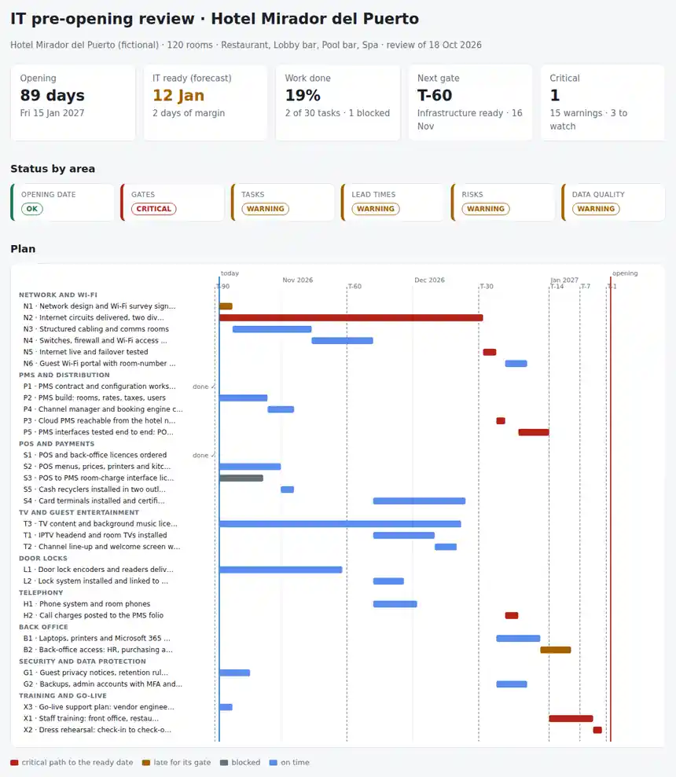

# Hospitality IT Pre-opening

A weekly review of the **IT side of opening a new hotel or restaurant**: network and Wi-Fi, PMS and distribution, POS and payments, TV, door locks, phones, back office, data protection and training, with the vendors' lead times and the dependencies between them. One task list, one Python command, and the answer to: **will IT be ready the day before opening, what is on the critical path, which gates are slipping, and what has to start this week?**

Python 3.10+, standard library only. Runs with fictional demo data out of the box.



## Why

In a pre-opening, every system depends on another one, and most of them depend on the internet line:

- the **internet circuits** have a 75-day lead time and were ordered late, so the cloud PMS, the room-charge interface and the call charges all slide with them,
- the **POS to PMS room-charge interface** is blocked because one vendor is waiting for the other to issue a licence,
- the **door lock encoders** ship from the factory and nobody knows if they arrive before the lock integration test,
- the **TV content and music licences** take two months to sign and have not started,
- **training** can only begin when the PMS interfaces are tested, and the dress rehearsal needs everything.

A spreadsheet lists the tasks; it does not say which delay moves the opening. This tool calculates it.

## What it does

| Area | What it calculates or checks |
|---|---|
| Schedule | Forward pass from the review date (calendar days, work left = duration × (1 − progress)) and backward pass from each task's gate: forecast start and finish, latest start and finish, float. |
| Opening date | Forecast date when IT is ready and the margin to the day before opening; critical if it falls later. |
| Critical path | The driving chain of tasks to the ready date: delay any of them and the ready date moves. |
| Gates | Gates already passed with open tasks (critical); tasks forecast to finish after the next gates (warning). Six default gates from T-90 (design frozen) to T-1 (ready to open), or your own. |
| Tasks | Late for their gate (critical when the delay reaches the opening), blocked (with the reason), on time but with no float. |
| Lead times | Tasks not started whose latest start is within 7 days or already passed. |
| Risks | Likelihood × impact: 15 or more is reviewed every week; open risks without a mitigation are flagged. Risk matrix in the report. |
| Data quality | Tasks without an owner, dependencies on unknown IDs, gates not defined in the project. Dependency loops stop the run with the loop printed. |

Outputs: `report.html` (single file, light and dark mode, with a Gantt chart of the plan, the gates, readiness by workstream and the risk matrix), `review.md` (Act now / This week / critical path / gates / readiness, ready for the weekly meeting), `actions.csv` (open tasks with forecast dates, float and critical-path flag), `findings.csv` and `golive_checklist.md` (the sign-offs from the last gates plus the checks for T-7, T-1, opening day and the first week).

How to run the weekly meeting and the gate reviews: [docs/weekly-meeting-runbook.md](docs/weekly-meeting-runbook.md). File format: [docs/data-format.md](docs/data-format.md).

## Try it

```bash
git clone https://github.com/inigogonzalezgarcia/24-hospitality-it-preopening.git
cd 24-hospitality-it-preopening
python -m preopen demo
```

Open `output/report.html`, `output/review.md` and `output/golive_checklist.md`.

The demo is a made-up 120-room resort hotel (Hotel Mirador del Puerto, `contoso.example`) with a restaurant, two bars and a spa, opening on 15 January 2027 and reviewed on 18 October 2026: 30 tasks in nine workstreams and six risks. Vendor names are Microsoft's fictional sample companies; people and dates are invented. Delays are placed on purpose: the network design is still open after the T-90 gate, the internet circuits finish a month after the T-60 gate and drive the critical path through the cloud PMS, the call charges, the PMS interface tests and training, the room-charge interface is blocked, the TV content licences must start this week, the back-office access and staff training slip past their gates, one task has no owner and one risk has no mitigation. IT is still forecast ready on 12 January, with two days of margin; review the same plan three weeks later without progress and the opening is at risk.

## Use it with your own plan

1. Write `data/project.json` with the property, the opening date and, if you want, your own gates.
2. Export your task list to `data/tasks.csv` (id, workstream, task, owner, vendor, duration in days, dependencies, gate, status, percent) and, optionally, `data/risks.csv`. Format: [docs/data-format.md](docs/data-format.md).
3. Build the outputs:
   ```bash
   python -m preopen report data/ --out output --title "IT pre-opening · week 12"
   ```
   Options: `--as-of 2026-11-08` (re-run the review for another date, for example to see what happens if nothing moves for three weeks) and `--start-soon-days 7`.

Real plans can contain vendor names, prices in notes and staff names. Real files at the top level (`project*.json`, `tasks*.csv`, `risks*.csv`, `data/`) and the `output/` folder are excluded from Git by `.gitignore`; only the fictional files in `sample_data/` are committed.

## Tests

```bash
python -m unittest discover tests      # or: pip install -r requirements-dev.txt && python -m pytest
```

14 tests: work left rounded up and finished tasks taking no time; status aliases in English and Spanish; the forward pass through dependencies and finished predecessors; the backward pass with gates and successors (float zero on a chain that just fits); the critical path as the driving chain; dependency loops; readiness weighted by duration; the opening at risk only when IT is ready after the day before; gates passed with open tasks and gates at risk; late, blocked and no-float tasks, including a late task whose chain reaches the opening; start-now lead times; risks with and without mitigation and closed risks; data quality; a semicolon CSV with custom gates and a project without an opening date; and the demo end to end (every check fires, the expected critical path, two days of margin, and the opening at risk when the same plan is reviewed three weeks later).

**Next steps for your opening:**

- export your pre-opening plan with real vendor lead times and dependencies,
- set your own gates in `project.json` if your brand or management company uses different milestones,
- run it before each weekly meeting and daily from T-7, and print the go-live checklist for the dress rehearsal.

## Background

Built from my years supporting hotel and restaurant technology at a technology consultancy: POS systems (ICG, HIOPOS) and cash recyclers (CashDro), hotel PMS and IPTV, and from later work on project planning, vendor management, go-live and service-acceptance reviews. The pre-opening model (gates, task network and checklist) is my own. Written from scratch with fictional data; no client or employer documents are used.

## Customisation and contact

Want this adapted to your opening (your brand's milestones, a link to your project tool, more workstreams such as CCTV or access control, a version for a restaurant group or several openings at once)? Get in touch:

- Website (contact form): [inigogonzalezgarcia.github.io](https://inigogonzalezgarcia.github.io/about.html#contacto)
- LinkedIn: [linkedin.com/in/igonzalez93](https://www.linkedin.com/in/igonzalez93)

## License

MIT
